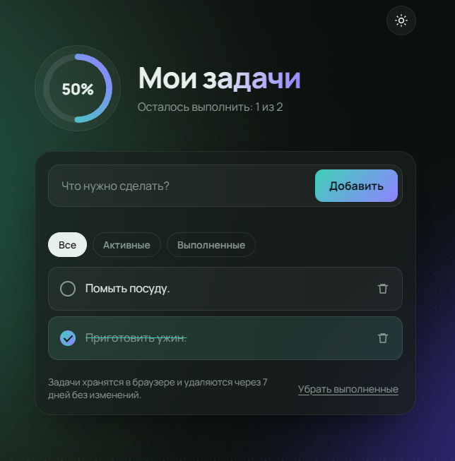

# Список задач

[](https://github.com/MiVaJ/todo-app/actions/workflows/ci.yml) [](https://mivaj.github.io/todo-app/)

Приложение для управления задачами на чистом JavaScript и Vite.

[](https://mivaj.github.io/todo-app/)
https://mivaj.github.io/todo-app/

## Возможности

- добавление, отметка выполненных и удаление задач
- защита от дубликатов: без учёта регистра и лишних пробелов, существующая задача подсвечивается
- кольцо прогресса и конфетти, когда выполнен весь список
- фильтры «Все / Активные / Выполненные»
- светлая и тёмная темы (системная по умолчанию, выбор запоминается)
- сохранение в `localStorage` с автоочисткой через 7 дней без изменений (`TTL` в `src/storage.js`)

## Запуск

```bash
npm install
npm run dev      # режим разработки
npm test         # тесты (Vitest)
npm run build    # сборка в dist/
```

## Структура

```
src/tasks.js     логика списка (чистые функции)
src/storage.js   localStorage и срок хранения
src/main.js      интерфейс
tests/           юнит-тесты логики и хранилища
.github/workflows/ci.yml   тесты, сборка и публикация на GitHub Pages
```

